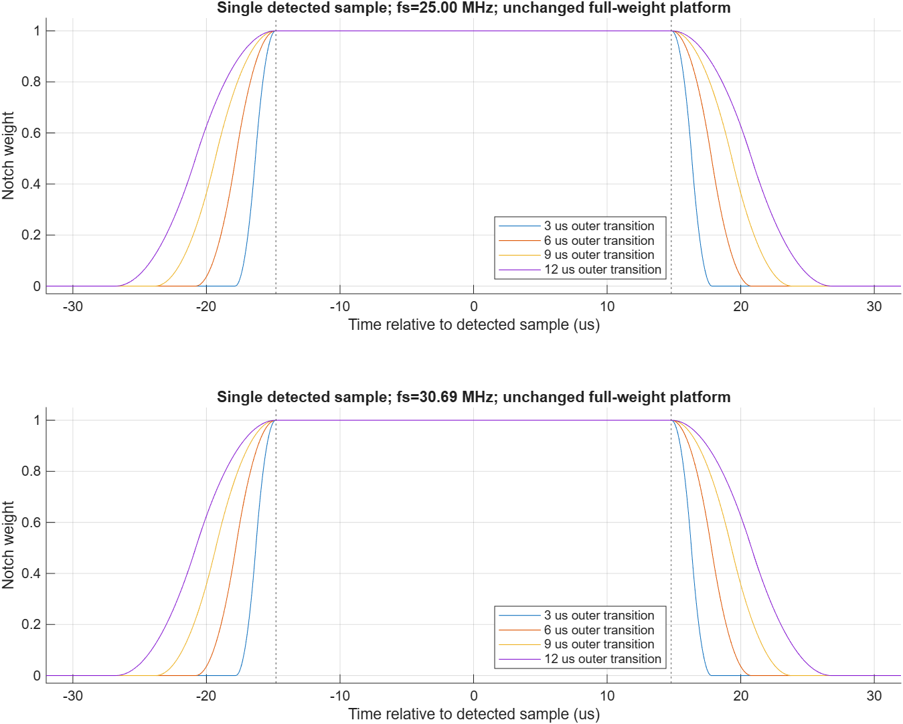
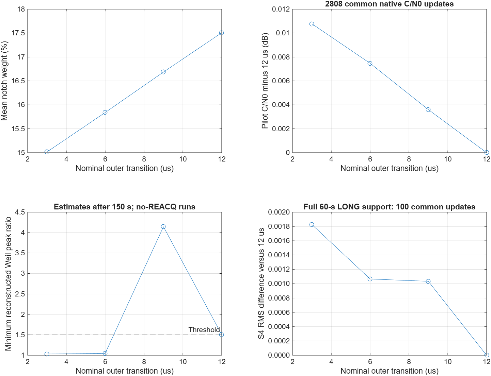
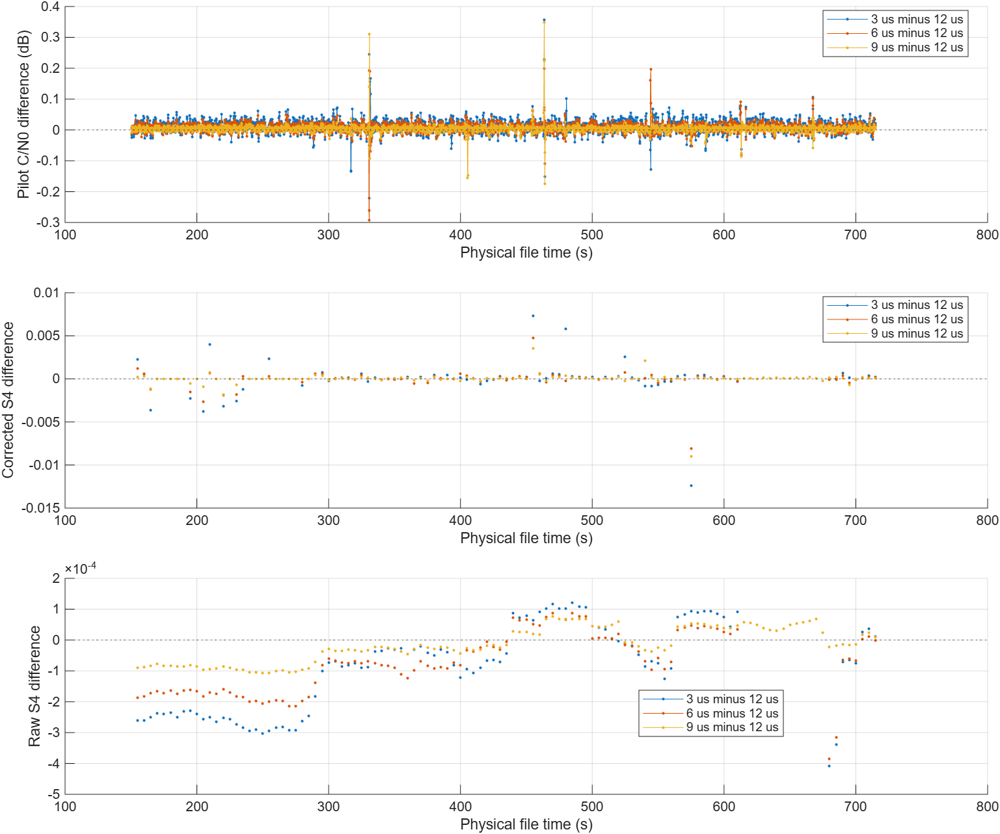
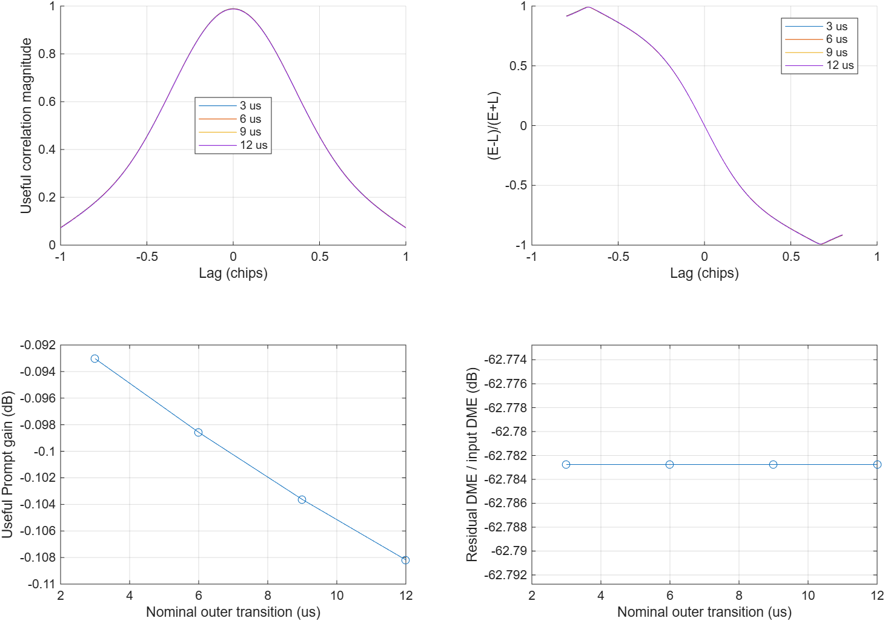

# 600 kHz 复数 FIR：3/6/9 μs 外侧软过渡实验

日期：2026-10-01。分支：`experiment/tf600-soft-edges`。**状态：三次 715 秒实测、共同窗口分析、Weil 判决审计与独立分量诊断全部完成。** 仅本地提交，不推送 GitHub。

**本组数据下建议优先采用 9 μs 作为三档中的候选。** 3/6 μs 的平均处理权重更低、共同窗口 C/N0 估计略高，但均发生一次额外的 3 秒 INIT 回退；9 μs 保持与原 12 μs 参考相同的跟踪连续性，在关键 Weil 重估时刻也有更大的判决余量。三档 C/N0 平均差只有 0.003–0.007 dB，没有证据表明这些微小差异对应 S4 准确度改善。这是单文件、单 PRN 的候选选择，不是全部干扰场景下的最优值；默认参数未自动修改。

## 1. 参数口径与控制条件

沿用第四组带干扰半物理数据 `720_2700_50_1176_25_37p5_17p5.dat`，PRN 11，25 MHz、int16 交织 IQ、skip=0，每档完整跟踪 715000 ms。三档唯一算法配置差异为 `Frontend.TF.triangleSpanUs=3/6/9`；保留此前 600 kHz、12 μs 归档作参考。

外侧过渡跨度定义为 **2K/fs**，不是三角核半跨度 K/fs。生产配置直接设置 `triangleSpanUs`，不得再乘 2。单位和三角核为 g[k]=max(K−|k|,0)/K²；检测集合扩展半径 A=D+P+K，权重为扩展掩码与 g 的卷积。其外侧边缘是分段二次累积曲线，不是线性斜坡。

固定参数：数字 IQ 中心 −450 kHz、深阻带总宽 600 kHz、单侧频率过渡带 150 kHz、641 抽头、Kaiser β=5.65326、幅度阈值 192.73917883288581、尾部裕量 2 μs。固定 D=320、P=50；三档 FIR 系数哈希一致。完整滤波平台始终覆盖检测区间向两侧扩展 D+P=370 样本（每侧 14.8 μs）的范围。

| 名义每个外侧过渡 | 实际 2K/fs | K | A | H=D+P+2K | H/fs |
|---|---:|---:|---:|---:|---:|
| 3 μs | 3.04 μs | 38 | 408 | 446 | 17.84 μs |
| 6 μs | 6.00 μs | 75 | 445 | 520 | 20.80 μs |
| 9 μs | 9.04 μs | 113 | 483 | 596 | 23.84 μs |
| 12 μs（历史参考） | 12.00 μs | 150 | 520 | 670 | 26.80 μs |

H 是所需真实前后文的保守样本半径，不是添加到跟踪时间轴的钟差。缩短边缘同时缩小扩展掩码 A 和前后文 H，使保证 w=1 的平台保持一致，不能只修改三角核而冻结 A。

## 2. 已完成的独立检查

`verify_tf_soft_edges` 覆盖 3/6/9/12 μs × 25/30.69 MHz × int8/int16，共 16 种组合。独立直接卷积、多种长度分块（含单样本块）、倒序读取、游标、EOF 原样旁路、quiet 逐值恒等、完整平台以及单位和检查均通过。一采样错位和缺失前后文两个负对照均被检出。

最大整块参考相对误差 6.894e−16，最大分块参考相对误差 6.913e−16。30.69 MHz 的抽头数为 787，K 按时间换算，没有固定为 25 MHz 的样本数。参考图和结果见本地 `results/tf600_soft_edges/run_01/verification/`。



## 3. 实际数据结果

三档 30 秒短段均完成，无重捕获、正常时间轴误差 0 样本。它们仍在 S4 预热阶段，不能据此判断 S4 性能。

| 外侧过渡 | 短段平均陷波权重 | Pilot C/N0 中位数 |
|---|---:|---:|
| 3 μs | 0.150117 | 45.98270 dB-Hz |
| 6 μs | 0.158362 | 45.99058 dB-Hz |
| 9 μs | 0.166811 | 45.98199 dB-Hz |

完整实验依次于 11:43:22、12:24:42、13:07:00 完成，编排于 13:07:12 结束。运行用时分别为 2274.81、2479.04、2537.57 秒；这是串行实验的墙钟记录，没有控制主机负载，不能据此证明跨度变化带来相同比例的计算加速。12 μs 复用此前已完成的同配置归档。

| 完整实验 | 平均陷波权重 | Pilot / total C/N0 中位数 | LONG 累计 | REACQ | 时间轴误差 | 有限 S4 更新 |
|---|---:|---:|---:|---:|---:|---:|
| 3 μs，715000 历元 | 0.150148 | 45.82586 / 48.90069 dB-Hz | 709 s | 0 | 0 样本 | 114 |
| 6 μs，715000 历元 | 0.158396 | 45.82392 / 48.89814 dB-Hz | 709 s | 0 | 0 样本 | 114 |
| 9 μs，715000 历元 | 0.166850 | 45.81857 / 48.89246 dB-Hz | 712 s | 0 | 0 样本 | 114 |
| 12 μs，历史参考 | 0.175063 | 45.81640 / 48.88792 dB-Hz | 712 s | 0 | 0 样本 | 114 |

各档前端边界无效历元均为 0，第一/最后逻辑样本位置一致。上述中位数不是配对差值；有限 S4 更新也不代表整个窗口均为 LONG。

### 3.1 处理占比

按实际样本数加权后，四档原始脉冲检测占比完全相同，均为 3.861113%。变化来自扩展掩码与软边缘，没有改变检测阈值。

| 外侧跨度 | 平均 w | 平均 w² | w>0 的样本比例 |
|---|---:|---:|---:|
| 3 μs | 15.0148% | 14.8171% | 15.8396% |
| 6 μs | 15.8396% | 15.4503% | 17.4841% |
| 9 μs | 16.6850% | 16.0998% | 19.1659% |
| 12 μs | 17.5063% | 16.7314% | 20.7963% |

9 μs 比 12 μs 的平均权重低 0.8213 个百分点，非零权重覆盖低 1.6305 个百分点。权重比例不是有用信号功率损失，也不等于计算量同比下降。

### 3.2 共同窗口的 C/N0

三档与历史参考共有 **2808 个 C/N0 更新**，覆盖 561.6 秒的原生更新网格。配对窗边缘最多相差 **0.04 μs，即 1 样本**；全部通过 ≤2 样本严格筛选。六组两两差值与原 `compare_tf_validation` 的结果逐一一致（脚本差值方向相反，已核对符号）。

| 外侧跨度 | 四档共同窗口 Pilot C/N0 均值 | 相对 12 μs 的 Pilot 均值差 |
|---|---:|---:|
| 3 μs | 44.783657 dB-Hz | +0.010777 dB |
| 6 μs | 44.780351 dB-Hz | +0.007471 dB |
| 9 μs | 44.776479 dB-Hz | +0.003599 dB |
| 12 μs | 44.772880 dB-Hz | 参考 |

3−6、3−9、6−9 μs 的 Pilot 平均差分别为 **+0.003306、+0.007178、+0.003872 dB**。对应 60 秒块的均值范围分别为 +0.001890～+0.005580、+0.005958～+0.007836、+0.002256～+0.005269 dB，各有 8 个覆盖率至少 98% 的块。120 秒块统计也保留在 JSON 中。这里的差异很小；重叠更新及同一记录内的块不等于独立重复实验，未据此构造总体显著性结论。

9 与 12 μs 单独配对时有 2824 个更新，Pilot 均值差 +0.003598 dB；与四档共用窗口的 +0.003599 dB 几乎一致。DLL/PLL 鉴别器统计亦已保存，它们是各自有效 LONG 样本上的内部量，不能作为对真值的码/载波误差。

### 3.3 INIT 回退与 Weil 置信度

3/6 μs 均在历元 **613001–616000**，即文件时间 **613.00042804–616.00042740 秒**进入 INIT；历元 616001 恢复 LONG。9/12 μs 在初始 3 秒跟踪初始化后，持续保持 LONG/LONG_FLL。

独立审计从归档 pilot 相关量还原 NH 符号，重新运行同一 100 ms Weil 相位搜索。四档各 **72 次**判决、共 **288 次**均与下一历元的归档状态相符。这里的“置信度”是现有程序的最大相关峰与次大峰之比，不是概率。

| 外侧跨度 | 613 秒处峰值比 | 判决阈值 | 判决与随后状态 |
|---|---:|---:|---|
| 3 μs | 1.029943 | 1.5 | 失败，退回 INIT |
| 6 μs | 1.047616 | 1.5 | 失败，退回 INIT |
| 9 μs | 4.143432 | 1.5 | 成功，保持 LONG |
| 12 μs | 1.506853 | 1.5 | 成功，保持 LONG；余量较小 |

四档在预热后最小峰值比均出现在这一时刻。3/6 μs 在 616 秒重估时分别以 5.945134/5.961528 成功恢复；没有触发 REACQ。这是现有状态机对相关量的响应，本次没有降低阈值来消除回退，也没有发现样本时间对齐错误。9 μs 在本事件上更有余量，但不能把一次事件推广为所有场景的稳定性保证。

### 3.4 S4 的完整窗口审核

3/6 μs 各有 **13 个**有限 S4 更新（约 615–675 秒）包含 INIT 历元；9/12 μs 没有这类窗口。原对照脚本仅按更新处 400 ms C/N0 支持筛选 S4，本次以新增脚本的完整 60000 历元有效 LONG 筛选为准。

四档共同保留 **100 个原生 S4 更新**，不插值。首个 150 秒输出因其 C/N0 支持起点早于预热边界而未纳入配对；包含 INIT 的完整窗口也被排除。

| 外侧跨度 | 相对 12 μs 的修正 S4 平均差 | 修正 S4 差值 RMS | 原始 S4 平均差 |
|---|---:|---:|---:|
| 3 μs | −0.00000604 | 0.00182651 | −0.00008472 |
| 6 μs | −0.00004585 | 0.00106589 | −0.00007154 |
| 9 μs | −0.00003832 | 0.00103351 | −0.00002321 |

3−9 与 6−9 μs 的修正 S4 差值 RMS 分别为 0.00111136、0.00040722。9 与 12 μs 单独配对可保留 113 个完整 LONG 更新，其平均差 −0.00002568、差值 RMS 0.00097319。上述 RMS 是两组估计之间的差异，不是对真值的 RMSE；去趋势 IIR 的无限历史影响也不因 60 秒筛选严格消失。没有证据据此宣称某档的 S4 测量更准确。





## 4. 完整结果的分析方法

排除前 150 秒预热，C/N0 按共同物理时间的原生 200 ms 更新配对，要求整个 400 ms 支持窗均为有效 LONG、至少 99% 重叠；同时给出 ≤2 样本边界偏差的严格子集与 60/120 秒块统计。另设三档及 12 μs 参考的共同窗口，避免把不同状态筛选集合的均值直接排序。

S4 必须在原生更新时刻比较，完整 60000 历元窗口均为有效 LONG；不插值，不把有限 S4 数量等同于全窗口稳定跟踪。去趋势 IIR 的历史影响不会因 60 秒筛选而严格消失。INIT 回退已使用归档 pilot 相关量重算 Weil 判决，本轮四档均无 REACQ。

比较平均陷波权重、权重平方、非零权重占比、C/N0、LONG/REACQ 覆盖和 S4 差异。权重比例不是等量的有用信号功率损失。没有逐点 S4 真值，不能用 S4 更小或 C/N0 更大直接宣称监测更准确。

## 5. 独立分量诊断

为解释取舍，另用已知 PRN 11、25 MHz、20 ms 数据构造 Gaussian DME 脉冲对：2700 对/秒、对内间隔 12 μs、σ=1.5 μs、峰值/检测阈值=10，中心 −450 kHz。对每档冻结由同一合成混合输入得到的检测权重，再按线性分量分离有用码和干扰残差。它没有热噪声、真实跟踪环或 S4 真值。

| 外侧跨度 | 合成有用 Prompt 增益 | 合成残差干扰能量/输入干扰能量 |
|---|---:|---:|
| 3 μs | −0.093029 dB | −62.782766 dB |
| 6 μs | −0.098575 dB | −62.782766 dB |
| 9 μs | −0.103628 dB | −62.782766 dB |
| 12 μs | −0.108180 dB | −62.782766 dB |

残差能量档间跨度仅约 2.97e−9 dB，在本诊断中可视为无实际差异；不是对真实 RF 数据给出了 62.78 dB 的抑制测量。9 μs 比 12 μs 的有用 Prompt 损失少约 0.00455 dB。四档在 1/32 样本搜索网格内相关峰均为 0 偏移，一采样错位负对照均返回 +1；最大独立分量参考相对误差为 8.10e−16。

这说明在给定合成脉形下，保留同一完整平台已经覆盖了主要干扰及 FIR 展宽，缩短外侧软边缘主要减少额外的有用分量处理。但实际闭环的 Weil 判决会变化，因此不能仅凭该无噪声诊断确定最优跨度，也不能把合成 Prompt 增益与真实 C/N0 差值直接相减。



## 6. 复现与项目记录

```matlab
setupPaths; addpath(fullfile(pwd,'tests'));
r = fullfile(pwd,'results','tf600_soft_edges','my_new_run');
b = fullfile(pwd,'results','upgrade_v020','full_01','tf600');
run_tf600_edge_comparison(r,b);
analyze_tf600_edges({fullfile(r,'full','edge3us'), ...
    fullfile(r,'full','edge6us'),fullfile(r,'full','edge9us'),b}, ...
    fullfile(r,'analysis'));
verify_tf_soft_edge_fidelity(fullfile(r,'fidelity'));
```

输出目录必须全新。实验驱动已本地提交为 `66c294c`，分析脚本后续独立提交；本轮固定 600 kHz，接收机版本仍为 v0.2.0。实际实验在用户共享的 `B2aTF800` / MATLAB R2026a 会话中串行执行，源码与 12 μs 基线运行路径一致。接收机默认值、生产代码与原始五组配置均未修改。主进度文件：`results/tf600_soft_edges/run_01/experiment_status.json`，最终状态 `complete`。

最终分析在 `run_01/analysis_final/`；首次 `analysis/` 的数值完全一致，只修正了总览图的标题与科学计数法排版。合成诊断位于 `run_01/fidelity/`。独立验证、三次 30/715 秒运行、288 次 NH 判决重构、六组 C/N0 交叉核对、四档合成分量与错位负对照均通过。小型 JSON/PNG 证据及内容哈希清单见 [evidence](evidence/)；完整 MAT、日志和测试 IQ 文件保留在本地 `results/`，不提交 Git。

建议后续以如下显式覆盖作为本组的 **9 μs 候选配置**，其他字段继续继承既有 config；本次未自动写回生产默认值：

```json
{
  "Frontend": {
    "mode": "tf_v1",
    "TF": {"stopbandWidthHz": 600000, "triangleSpanUs": 9}
  }
}
```

30.69 MHz/int8 目前仅有独立前端检查，本次完整实测为 25 MHz/int16 IQ。若要确定跨场景的主参数，还应在其余带干扰文件和不同 PRN 上检查同样的状态连续性、Weil 余量和监测偏差。
