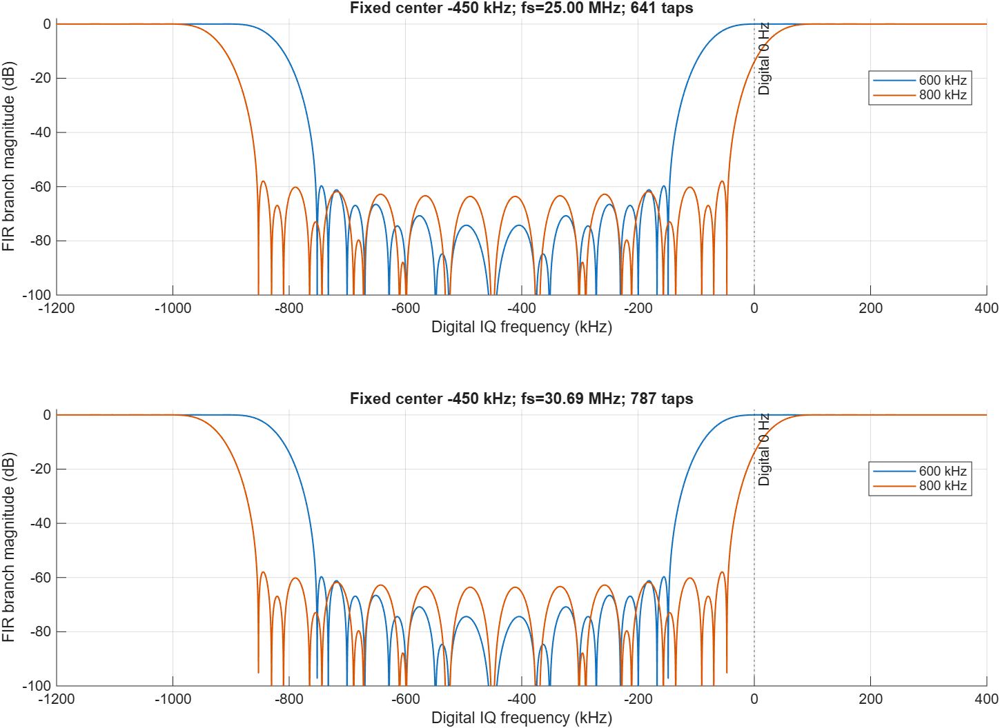
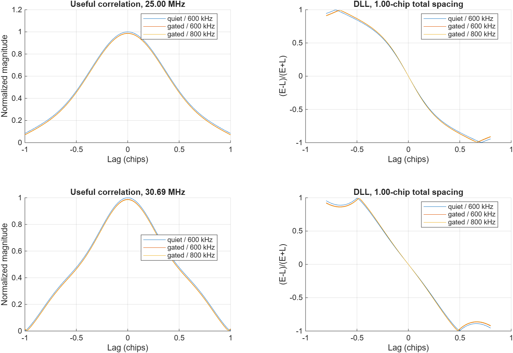
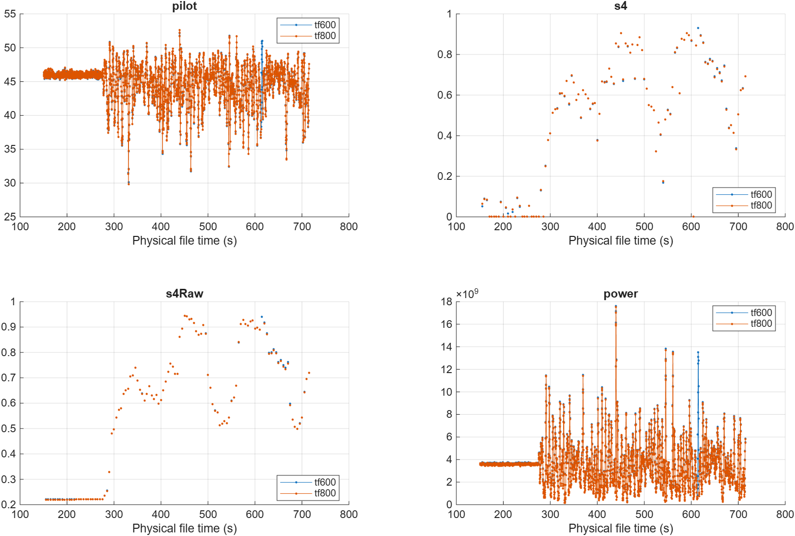
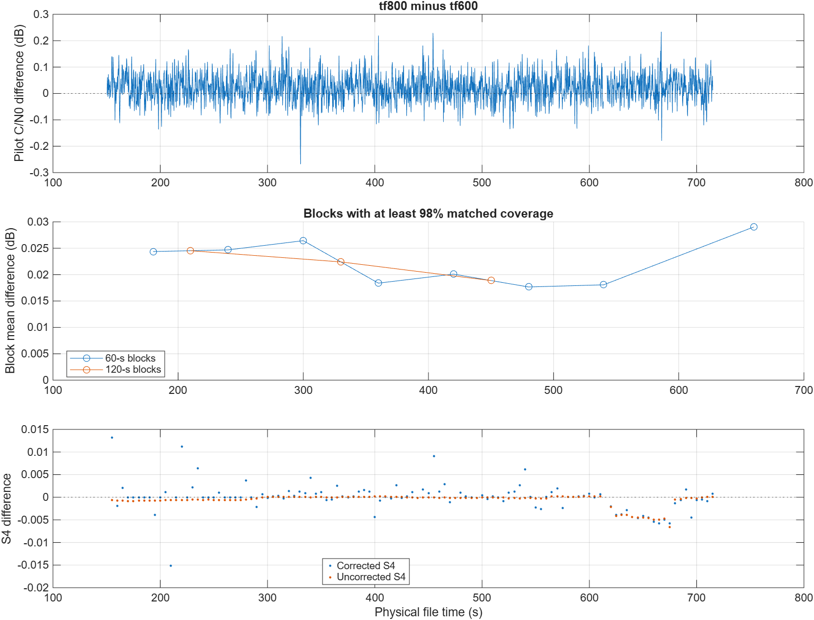

# 复数 FIR 600/800 kHz 对照实验

日期：2026-10-01。状态：800 kHz 的 715 秒实际实验、600/800 配对分析及状态审计均已完成。使用本地分支 `experiment/tf600-vs-tf800`，不推送 GitHub。

**本组数据建议继续保留 600 kHz 作为跟踪实验候选。** 800 kHz 的共同窗口 pilot C/N0 平均仅高 0.02248 dB，同时出现一次额外的 3 秒 INIT 回退；没有证据表明它改善了 S4 测量准确度。该结论只适用于本次文件、PRN 和固定参数，不是四组干扰数据上的最优带宽结论。接收机默认值仍为 400 kHz，本次没有修改。

## 1. 对照条件

沿用第 4 组带干扰数据 `720_2700_50_1176_25_37p5_17p5.dat`，2700/−50 dBm，PRN 11，715000 ms，25 MHz、int16 交织 IQ、skip=0。600 kHz 基线为 `results/upgrade_v020/full_01/tf600/`；800 kHz 新运行位于 `results/tf600_vs_tf800/run_03/`。两份配置仅深阻带总宽和输出标签不同。

接收机源码与 v0.2.0 一致；当前实验驱动提交为 `6da2978`。固定数字 IQ 中心 −450 kHz、每侧过渡带 150 kHz、641 抽头、Kaiser β=5.65326、幅度阈值 192.73917883288581、三角核跨度 12 μs、尾部裕量 2 μs、D/K/P/H=320/150/50/670。捕获和跟踪均使用各自带宽的前端，原环路与监测公式保持不变。

600 kHz 记录先前已完成且同为 MATLAB R2026a 26.1.0.3203278。运行前核查了源码指纹；与更早完整运行的唯一运行时源码差异是已独立验证的探针显示修复，本次跟踪不调用该路径。没有重新计算 600 kHz 基线。

## 2. 滤波器与相关诊断

| 项目 | 600 kHz | 800 kHz |
|---|---:|---:|
| 深阻带范围（数字 IQ 坐标） | −750 至 −150 kHz | −850 至 −50 kHz |
| 含两侧过渡带的范围 | −900 至 0 kHz | −1000 至 +100 kHz |
| 25 MHz、641 抽头的网格最差阻带 | −59.712 dB | −57.947 dB |
| 30.69 MHz、787 抽头的网格最差阻带 | −59.698 dB | −57.938 dB |
| 25 MHz 下 FIR 支路的 0 Hz 响应 | +0.0034 dB | −13.9515 dB |

阻带值由深阻带内 4001 点网格计算，不是连续频率极值保证。带宽变化时保留同一抽头数和窗参数，没有针对 800 kHz 另行调参。800 kHz 的上侧过渡带跨过数字 0 Hz，因此会额外削弱部分有用信号频谱。表中 0 Hz 响应仅描述全权重 FIR 支路，不能当成整个门控输出或 GNSS 相关量的损失。

前端 10 项测试通过，覆盖 int8/int16 × 25/30.69 MHz × 400/600/800 kHz 共 12 种组合。包括随机分块、1 样本块、反向 seek、EOF、独立双支路参考，以及一采样错位/去掉 halo 的负对照。

已知 PRN 11 的独立相关诊断采用两个采样率、600/800 kHz 及 quiet/continuous/gated 三种状态，共 12 组。与独立直接卷积双支路参考的最大相对误差为 7.33e-15；quiet 输出逐值恒等，1/32 样本搜索网格内峰位均为 0，一采样错位负对照均被检出。DLL 间距沿用配置的单边 0.5 chip。

| 采样率 | 带宽 | 连续滤波有用 Prompt 增益 | 门控有用 Prompt 增益 | 门控 DLL 零点偏差 |
|---|---:|---:|---:|---:|
| 25 MHz | 600 kHz | −0.68390 dB | −0.10817 dB | −3.291e-7 chip |
| 25 MHz | 800 kHz | −0.85403 dB | −0.13426 dB | −9.762e-7 chip |
| 30.69 MHz | 600 kHz | −0.66136 dB | −0.10469 dB | −4.439e-7 chip |
| 30.69 MHz | 800 kHz | −0.83025 dB | −0.13080 dB | −1.446e-6 chip |

此处隔离的是相同检测权重下的有用码分量；合成脉冲和阈值比例固定，没有热噪声、真实跟踪环或 S4 真值。800 kHz 的门控平均有用 Prompt 损失比 600 kHz 多约 0.0261 dB；不能据此单独决定实际干扰下的 C/N0 或监测优劣。





## 3. 实际跟踪结果

800 kHz 的 30 秒实际短段已通过：30000 历元、无 REACQ、前端核心全部有效、正常时间轴误差 0 样本；pilot/total C/N0 中位数为 46.00473/49.06345 dB-Hz。短段尚在 S4 预热范围内，无有效 S4 更新。该结果只作短段运行检查。

完整 TF800 于 08:25:01 开始、09:08:35 完成，运行用时 2618.85 秒；全部编排于 09:08:50 结束。600 kHz 使用此前已完成的归档结果，两个时间点的运行耗时不用于性能基准比较。

| 全段指标 | 600 kHz | 800 kHz |
|---|---:|---:|
| 完整记录历元 | 715000 | 715000 |
| REACQ 历元 | 0 | 0 |
| LONG/LONG_FLL 总时长 | 712 s | 709 s |
| 正常文件时间轴误差 | 0 样本 | 0 样本 |
| 前端边界无效历元 | 0 | 0 |
| 平均陷波权重 | 0.175063 | 0.175063 |
| pilot C/N0 中位数 | 45.81640 dB-Hz | 45.83550 dB-Hz |
| total C/N0 中位数 | 48.88792 dB-Hz | 48.91058 dB-Hz |
| 有限 S4 更新数（尚未筛选完整 LONG 窗口） | 114 | 114 |

### 3.1 共同窗口的 C/N0

排除前 150 秒预热，并要求两侧 400 ms C/N0 支持窗均为有效 LONG 状态后，共有 2808 个配对更新，覆盖 561.6 秒的更新网格。最大窗口边缘偏差为 0.04 μs，即 25 MHz 下 1 样本；全部也满足不超过 2 样本的严格配对要求。以下差值均为 800−600：

| 配对指标 | 结果 |
|---|---:|
| pilot C/N0 平均差 | +0.022482 dB |
| pilot C/N0 差值中位数 | +0.020825 dB |
| pilot C/N0 差值 5% / 95% 分位 | −0.058378 / +0.105458 dB |
| pilot C/N0 差值为正的更新比例 | 67.70% |
| total C/N0 平均差 | +0.021524 dB |
| 60 秒块均值范围，8 块 | +0.017660 至 +0.029036 dB |
| 120 秒块均值范围，3 块 | +0.018875 至 +0.024530 dB |

块统计要求至少 98% 配对覆盖，包含 INIT 回退的块不满足要求。它们描述本段内部的一致性，不是不同数据集的独立重复试验。约 0.02 dB 的估计量提升很小，不足以单独支持扩大带宽。不能将合成诊断中的有用信号损失直接与此处实测 C/N0 差值相减。

稳态 DLL 无量纲鉴别器标准差为 0.122798/0.123466，PLL 鉴别器标准差为 0.0568955/0.0568926 cycles（600/800）。这些是各自有效 LONG 历元的内部统计，不是对真值的跟踪误差；样本集合也因 INIT 区间而不同。

### 3.2 额外 INIT 回退已定位

800 kHz 在历元 613001–616000（文件时间 613.00042804–616.00042740 秒）退回 INIT，历元 616001 恢复 LONG。600 kHz 从历元 3001 起持续保持 LONG/LONG_FLL。

独立脚本从归档的 pilot 相关量恢复每次估计前的 NH 符号，重算原 100 ms 缓冲区的 Weil 相位搜索及峰值比。两组各 72 次重算判决均与下一历元归档状态一致：

| Weil 重估时刻 | 600 kHz 置信度 | 800 kHz 置信度 | 阈值 |
|---|---:|---:|---:|
| 603 s | 5.413110 | 5.415554 | 1.5 |
| 613 s | 1.506853，成功 | 1.004432，失败 | 1.5 |
| 616 s | 未触发该次重估 | 6.049441，成功 | 1.5 |

这对应现有 `NH_stateMachine` 的定期 LONG→ESTI、估计失败→INIT、3 秒后重新估计成功→LONG 路径；未发生 REACQ。600 kHz 在 613 秒也仅略高于阈值，因此不能把单次通过解释为充足的稳定性余量。本次没有为某个带宽修改置信度阈值、环路或状态机。

### 3.3 S4 必须审核完整 60 秒窗口

归档中两组均有 114 个有限 S4 更新，但现有计算器的 `valid` 不要求整个窗口均为 LONG，`allLong` 是另一个状态量。因此有限更新数不等于全窗口稳定跟踪。

原 `compare_tf_validation` 只按更新处的 400 ms C/N0 支持筛选 S4，保留 112 对；此口径下平均 S4 差为 −0.0000181、差值 RMS 为 0.0031664。新增状态审计进一步要求完整 60000 历元均为有效 LONG，保留 **100 对**；平均差改为 **+0.0005025**，差值 RMS 为 **0.0029693**，最大绝对差为 **0.0151942**，原始未作热噪声修正 S4 的平均差为 −0.0001931。两种口径的差值均不是相对真值误差。

800 kHz 在 615–675 秒的 13 个 S4 输出，其统计窗口包含 INIT 历元；原配对已排除 615 秒更新，新审计再排除 620–675 秒的 12 个更新。首个 150 秒更新因 C/N0 支持起点小于 150 秒也未进入配对。60 秒筛选只移除统计窗内的状态混杂，不代表去趋势 IIR 的无限记忆已严格消失。没有逐点 S4 真值，不能根据平均差的正负或大小声称某档更准确。





## 4. 复现与执行记录

```matlab
setupPaths; addpath(fullfile(pwd,'tests'));
run_tf800_comparison(fullfile(pwd,'results','tf600_vs_tf800','my_new_run'));
```

完整运行之后，在新输出位置生成补充分析：

```matlab
r = fullfile(pwd,'results','tf600_vs_tf800','my_new_run');
b = fullfile(pwd,'results','upgrade_v020','full_01','tf600');
plot_tf_bandwidth_differences(fullfile(r,'comparison'));
plot_tf600_tf800_response(fullfile(b,'validation_config.json'), ...
    fullfile(r,'filter_response.png'));
audit_tf_bandwidth_states({b,fullfile(r,'full','tf800')}, ...
    fullfile(r,'comparison'),fullfile(r,'state_audit'));
```

入口拒绝覆盖已有目录，先校验基线与源码，再运行前端测试、相关诊断、30 秒和 715 秒 TF800，最后以物理文件时间配对 600/800 kHz。保留 150 秒预热，C/N0 每 200 ms 更新且存档值有 400 ms 时间支持；比较要求完整有效 LONG 窗及至少 99% 重叠，并报告不超过 2 样本错位的严格子集、60/120 秒块统计。S4 仅比较原生更新，不插值、不以高度重叠更新数充当独立试验数；本报告以补充审计的完整 60 秒筛选作为主要 S4 口径。

此前 MCP 附着和新 MATLAB 批处理启动失败，`run_01` 保留启动崩溃记录。用户共享 `B2aTF800` 后成功连接。`run_02` 暴露实验驱动 evalc 静态工作区分配问题，修复后新建 `run_03`；这些失败均在实际 RF 跟踪开始前，没有将失败记录当成算法结果。

本对照只覆盖一个文件、一个 PRN。没有逐点 S4 真值，不能把更高 C/N0 估计值或更低 S4 直接解释为监测更准确。接收机默认带宽和用户原始配置均未修改。

## 5. 交付与适用范围

实验代码提交为 `7b5c47d`，驱动静态工作区修复提交为 `6da2978`；后续报告和归档提交可用 `git log -- docs/tf600_vs_tf800 tests/audit_tf_bandwidth_states.m` 查询。本轮只增加测试编排、800 kHz 测试覆盖、独立分析与报告，接收机运行时代码保持 v0.2.0。10 项前端测试、12 组相关诊断、30/715 秒实测、144 次 NH 判决重构以及配对差值一致性断言均通过。

小型 JSON/PNG 证据保存于 [evidence](evidence/)，包括两侧运行摘要、配置、频响、相关诊断、完整状态审计及内容哈希清单。完整 MAT 和日志保留在本地 `results/`，未纳入 Git。无需重新跟踪即可复核图表和状态。用户共享的 MATLAB 会话保持打开。

800 kHz 可继续作为可配置实验档；当前没有充分收益支持替换本组的 600 kHz 候选。若进一步判定最优带宽，应在其余三组干扰文件上按同一冻结配置比较，并检查弱信号/深衰落时的 Weil 置信度余量及参考 S4。30.69 MHz 和 int8 已通过独立前端/相关验证，本次完整实测只覆盖 25 MHz、int16 IQ。
