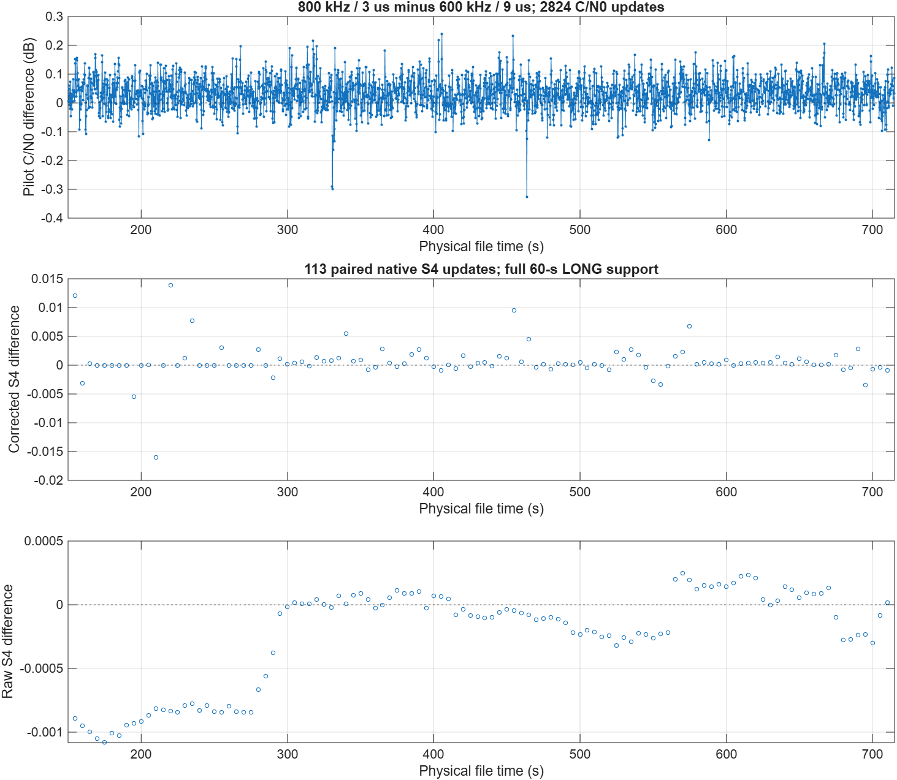
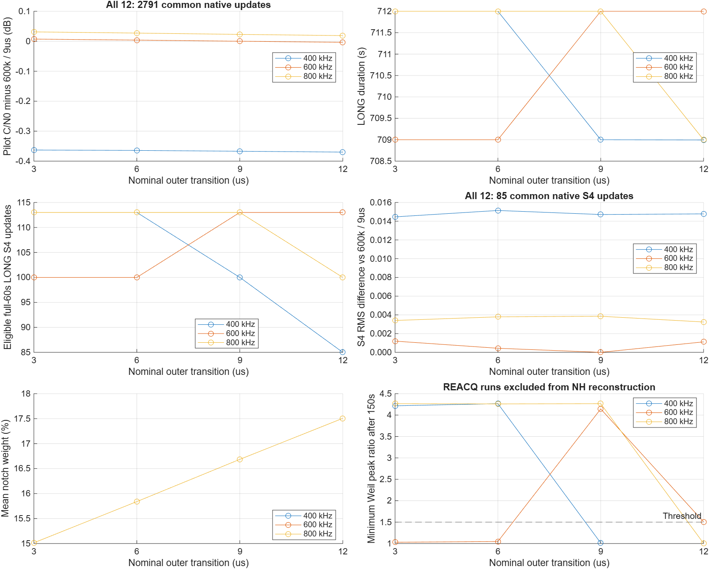
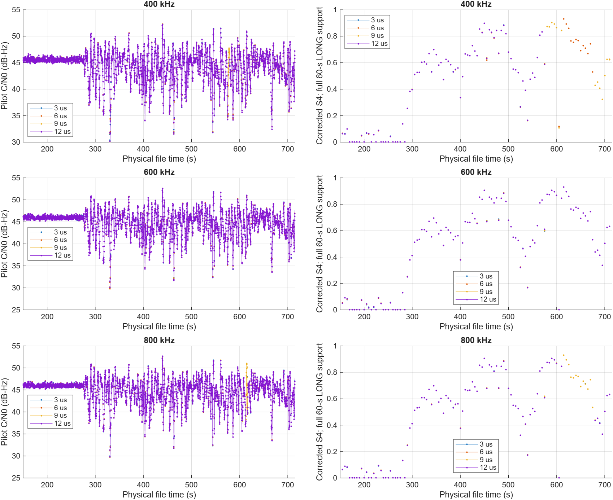
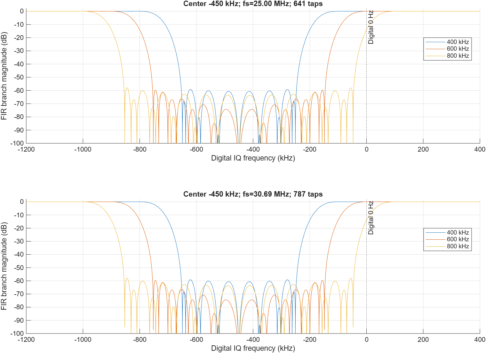

# 复数 FIR 时频消隐器参数选择报告

日期：2026-10-01。接收机版本：v0.2.0。实验分支：`experiment/tf-bandwidth-edge-grid`。**400/600/800 kHz × 3/6/9/12 μs 共 12 个组合已完成比较；本轮新增六次 715 秒实测及六次 30 秒检查。**

**针对本次第 4 组干扰数据、PRN 11，建议将 800 kHz／3 μs 作为抑制优先的主实验候选，600 kHz／9 μs 保留为较窄带宽备选。** 800 kHz 的 3/6/9 μs 均保持连续 LONG；3 μs 具有较低处理权重、较小的合成有用码损失和略高的实测 C/N0。它也没有出现此前 800 kHz／12 μs 的额外 INIT，因此完整二维参数实验更新了此前固定 12 μs 时偏向 600 kHz 的选择。

这一推荐是本文件、本卫星和冻结参数下的工程选择，**不是四组干扰文件的总体最优值，也不是 S4 准确度最优值**。接收机生产源码、原始五组配置和默认 400 kHz／12 μs 均未自动修改；本轮只增加实验、分析及报告，所有提交保留在本地，未推送 GitHub。

## 1. 实验条件和参数定义

使用 `F:\Data\DME_BDSB2a\Spirent2026\new_atc5000\720_2700_50_1176_25_37p5_17p5.dat`，即第 4 组 2700／−50 dBm 半物理输入。文件大小 72,000,240,000 字节，修改时间 2026-04-21 11:05:04；记录了输入元数据，未对整个 72 GB 输入另算内容哈希。所有组合均为 PRN 11、25 MHz、int16 交织 IQ、skip=0、715000 个 1 ms 历元，串行执行，关闭导航、NMEA 和交互绘图。

| 固定项目 | 采用值 |
|---|---|
| 前端模式 | `Frontend.mode='tf_v1'`；与 PB 互斥 |
| 数字 IQ 干扰中心 | −450 kHz |
| 频域参数 | 深阻带**全宽** 400/600/800 kHz；每侧过渡带 150 kHz |
| FIR | 复数抽头，25 MHz 时 641 抽头，Kaiser β=5.65326 |
| 幅度检测阈值 | 192.73917883288581，继承 `PB_settings.Th_static_tracking` |
| 脉冲尾部裕量 | 2 μs，即 P=50 样本 |
| 跟踪与 NH | 1 ms 积分；Weil 缓冲 100 ms，重估间隔 10 s，失败后 INIT 3 s，峰值比阈值 1.5 |
| C/N0 | 每 200 ms 更新；保存值包含相邻两窗，支持长 400 ms |
| S4 | 60000 历元窗、5 s 更新、0.1 Hz 去趋势、150 s 预热 |

其余参数继承既有配置，含 DLL 单边间距 0.5 chip、PLL/DLL/FLL 参数及保护阈值。运行前核对历史基线源码指纹，分析时核对每个完整 MAT 中的前端配置哈希与保存配置一致。历史探针显示修复不进入本次跟踪路径。

### 1.1 “3/6/9/12 μs”的准确含义

`triangleSpanUs` 是**每个外侧过渡的跨度 2K/fs**。三角核单位和归一化，先扩展检测掩码，再卷积：

\[
m[n]=\mathbf 1\{|r[n]|\ge T\},\quad
d_A[n]=\max_{|j|\le A}m[n-j],\quad
g[k]=\frac{\max(K-|k|,0)}{K^2},\quad
w[n]=(d_A*g)[n].
\]

令 D=(L−1)/2，`K=round(spanUs·10⁻⁶·fs/2)`，`A=D+P+K`，`H=D+P+2K`。在 25 MHz 下 D=320；各档都保证检测区外 D+P=370 样本、即 14.8 μs 的全权重平台半径。改变跨度时同时换算 A/H，保证平台覆盖要求一致。阶跃掩码与三角核卷积形成的软边缘是分段二次过渡，不是直接拼接线性斜坡。

| 名义外侧跨度 | 实际 2K/fs | K | A | H | H/fs |
|---|---:|---:|---:|---:|---:|
| 3 μs | 3.04 μs | 38 | 408 | 446 | 17.84 μs |
| 6 μs | 6.00 μs | 75 | 445 | 520 | 20.80 μs |
| 9 μs | 9.04 μs | 113 | 483 | 596 | 23.84 μs |
| 12 μs | 12.00 μs | 150 | 520 | 670 | 26.80 μs |

H 是读取真实前后文的保守半径；FIR 分支按 D 对齐原始逻辑样本。D/H 不添加到 GNSS 逻辑时间戳。采样率改变时，抽头数按原规则换算：`L=2·ceil(320·fs/25 MHz)+1`，30.69 MHz 时为 787；允许配置显式覆盖。K/P 也按时间换算。这里的实际 RF 结论来自 25 MHz/int16；30.69 MHz/int8 的证据是独立前端验证。幅度阈值属于当前 ADC 标度，不能把本次 int16 数值直接移植到未经相同幅度归一化的 int8 数据。

## 2. 实测完整性、跟踪状态和 S4 可用性

本轮批处理于 13:27:32 启动，六次完整实测于 17:52:40 全部结束；12 组联合分析于 17:55:03 完成。六次完整运行各耗时约 39.6–44.3 分钟，耗时未控制主机负载，不作为实时性或算法加速基准。

**全部 12 组均完整保存 715000 历元，正常相邻历元的时间轴误差均为 0 样本，前端无无效核心历元。** 下表的 LONG 包含 LONG_FLL；“额外非 LONG”不计最初共同的 3 秒初始化。S4“严格可用”要求完整 60 秒均有效 LONG，同时满足本文预热和更新支持筛选。

| 带宽 kHz | 跨度 μs | LONG 累计 s | 额外非 LONG ms | REACQ ms | 有限 S4 / 严格可用 S4 |
|---:|---:|---:|---:|---:|---:|
| 400 | 3 | 712.000 | 0 | 0 | 114 / 113 |
| 400 | 6 | 712.000 | 0 | 0 | 114 / 113 |
| 400 | 9 | 709.000 | 3000 | 0 | 114 / 100 |
| 400 | 12 | 708.994 | 3006 | 6 | 86 / 85 |
| 600 | 3 | 709.000 | 3000 | 0 | 114 / 100 |
| 600 | 6 | 709.000 | 3000 | 0 | 114 / 100 |
| 600 | 9 | 712.000 | 0 | 0 | 114 / 113 |
| 600 | 12 | 712.000 | 0 | 0 | 114 / 113 |
| 800 | 3 | 712.000 | 0 | 0 | 114 / 113 |
| 800 | 6 | 712.000 | 0 | 0 | 114 / 113 |
| 800 | 9 | 712.000 | 0 | 0 | 114 / 113 |
| 800 | 12 | 709.000 | 3000 | 0 | 114 / 100 |

由此得到七个初始化后持续 LONG 的组合：400/3、400/6、600/9、600/12、800/3、800/6、800/9。它们均保留 113 个严格可用的原生 S4 输出。114 个有限输出中的首个约 150 秒点，因其 C/N0 支持窗起点早于 150 秒而未进入严格配对。

400/9、600/3、600/6、800/12 均在历元 613001–616000 回退 INIT，文件时间约 613.000428–616.000427 秒，随后恢复 LONG。每组均有 13 个有限 S4 输出（约 615–675 秒）的完整统计窗含 INIT，因此严格可用数为 100。不能把“有限 S4 数仍为 114”解释为监测覆盖没有受到影响。

400/12 的历史记录在约 575.600436 秒发生一次 6 ms REACQ，并经历后续 3 秒初始化。事件前 200 ms 的 PLL NCO 近限占比为 1，高于保护占比阈值 0.7，与饱和保护触发一致；前端没有无效样本。接续时回退 24999 个采样，属于已核验的尾码周期重接。S4 重捕获重置后的预热使后段没有恢复有限输出，本段只有 86 个有限、85 个严格可用 S4。

### 2.1 Weil 判决复核

从保存的 pilot 相关量还原 NH 符号并重新计算相同的 100 ms 相位搜索：**11 个无 REACQ 组合共 792 次判决全部与归档状态一致**。含 REACQ 的 400/12 不套用无重捕获的相位锚点，而单独审计 PLL 保护与接续时间。

| 带宽 kHz | 跨度 μs | 150 秒后最小峰值比 | 最小值历元 | 613 秒重估峰值比 |
|---:|---:|---:|---:|---:|
| 400 | 3 | 4.216458 | 553000 | 4.517873 |
| 400 | 6 | 4.266855 | 553000 | 4.525066 |
| 400 | 9 | 1.012883 | 613000 | 1.012883 |
| 400 | 12 | - | REACQ | - |
| 600 | 3 | 1.029943 | 613000 | 1.029943 |
| 600 | 6 | 1.047616 | 613000 | 1.047616 |
| 600 | 9 | 4.143432 | 613000 | 4.143432 |
| 600 | 12 | 1.506853 | 613000 | 1.506853 |
| 800 | 3 | 4.266696 | 393000 | 4.685403 |
| 800 | 6 | 4.260134 | 393000 | 4.684566 |
| 800 | 9 | 4.266923 | 393000 | 4.571977 |
| 800 | 12 | 1.004432 | 613000 | 1.004432 |

统一阈值为 1.5。600/12 的 1.506853 仅略过阈值；600/9、800/3/6/9 在本记录中的余量更大。峰值比不是概率，也不是跨场景的稳定性保证。未为任何参数组合调低 NH 或 PLL 保护阈值。

## 3. 共同物理时间窗口比较

不按数组下标硬配、不插值。C/N0 要求完整 400 ms 支持均有效 LONG，支持起点不早于 150 秒，双方物理支持至少重合 99%；重复物理时间分箱全部剔除。同时记录边缘偏差不超过 2 个采样的严格子集。S4 还要求完整 60000 原生历元均有效 LONG，并核对完整支持的物理重合。

全部 12 组共有 **2791 个 C/N0 更新、85 个 S4 更新**，C/N0 更新网格覆盖 558.2 秒；严格 ≤2 样本子集为 2127 个更新。差别主要来自 400/12 重捕获后的约 1 ms 物理回退，其 400 ms 窗仍满足 99% 重合。下表采用同一 12 组共同集合，差值参考为 600/9，**参考组不是 S4 真值**。

| 带宽 kHz | 跨度 μs | Pilot C/N0 均值 dB-Hz | ΔPilot vs 600/9 dB | 修正 S4 平均差 | 修正 S4 差值 RMS |
|---:|---:|---:|---:|---:|---:|
| 400 | 3 | 44.411772 | -0.362911 | -0.00389556 | 0.01446302 |
| 400 | 6 | 44.410410 | -0.364272 | -0.00421550 | 0.01514564 |
| 400 | 9 | 44.407680 | -0.367003 | -0.00404095 | 0.01471211 |
| 400 | 12 | 44.404868 | -0.369814 | -0.00401907 | 0.01478188 |
| 600 | 3 | 44.781844 | +0.007161 | +0.00001226 | 0.00119780 |
| 600 | 6 | 44.778558 | +0.003875 | -0.00001193 | 0.00043547 |
| 600 | 9 | 44.774683 | +0.000000 | +0.00000000 | 0.00000000 |
| 600 | 12 | 44.771072 | -0.003610 | +0.00004875 | 0.00111760 |
| 800 | 3 | 44.805884 | +0.031201 | +0.00074746 | 0.00340226 |
| 800 | 6 | 44.801959 | +0.027276 | +0.00085290 | 0.00379041 |
| 800 | 9 | 44.797487 | +0.022804 | +0.00092158 | 0.00385258 |
| 800 | 12 | 44.793504 | +0.018821 | +0.00068433 | 0.00323977 |

85 个共同 S4 点受到 400/12 后段缺测限制，不能代表整个后段。因此另取七个持续 LONG 组合：共有 **2824 个 C/N0 更新和 113 个 S4 更新**，C/N0 更新网格覆盖 564.8 秒，全部也满足 ≤2 样本严格配对。该集合用于主候选之间的比较；各组缺测和回退已在上一节独立报告，没有通过共同掩码隐去。

### 3.1 主候选 800/3 与备选 600/9

以下均为 **800 kHz／3 μs 减 600 kHz／9 μs**：

| 指标 | 结果 |
|---|---:|
| 共同原生 C/N0 更新 | 2824 |
| 最大 C/N0 支持边缘偏差 | 0.04 μs，约 1 个采样 |
| Pilot C/N0 平均差 / 差值中位数 | +0.031230 / +0.030401 dB |
| Total C/N0 平均差 | +0.029827 dB |
| 9 个覆盖率≥98%的 60 秒块均值范围 | +0.024709～+0.035749 dB |
| 4 个 120 秒块均值范围 | +0.027837～+0.034133 dB |
| 共同完整 LONG 的 S4 更新 | 113 |
| 修正 S4 平均差 / 差值 RMS | +0.000622666 / 0.002998482 |
| 修正 S4 最大绝对差 | 0.015967194 |
| 原始 S4 平均差 | −0.000231666 |

C/N0 增量约 0.03 dB，虽在上述块均值中同号，幅度仍很小；同一文件的重叠更新与分块不构成独立重复试验。没有逐点 S4 真值，差值 RMS 不是 RMSE，不能据此声称 800/3 的监测更准确。完整 60 秒筛选也不会严格消除去趋势 IIR 的无限历史影响。



### 3.2 各带宽内部的跨度效果

各带宽分别取四档共同窗口，以本带宽 12 μs 为参考。400 kHz 使用 2791 个 C/N0、85 个 S4；600/800 kHz 各使用 2808 个 C/N0、100 个 S4。表中每格为“Pilot 平均差 dB；S4 差值 RMS”，用于描述差异，不是准确度排名。

| 带宽 | 3 μs − 12 μs | 6 μs − 12 μs | 9 μs − 12 μs |
|---|---:|---:|---:|
| 400kHz | +0.006903; 0.00104587 | +0.005542; 0.00157020 | +0.002812; 0.00057932 |
| 600kHz | +0.010777; 0.00182651 | +0.007471; 0.00106589 | +0.003599; 0.00103351 |
| 800kHz | +0.012360; 0.00090542 | +0.008425; 0.00123196 | +0.003983; 0.00125213 |

缩短外侧过渡的 C/N0 增量仅约 0.003–0.012 dB；更有区分力的是状态连续性。400 kHz 下 3/6 μs 优于本次 9/12 μs 的连续性；600 kHz 下应保留 9 μs；800 kHz 下 3/6/9 μs 均连续，3 μs 的处理范围最小。不能据此推广为“任何带宽都应取最短过渡”。





## 4. 处理占比、频率响应及合成分量诊断

### 4.1 时间处理范围

在连续物理样本覆盖相同的记录中，按采样数加权的原始检测占比均为 3.861113%；它只由输入与幅度阈值决定。同跨度下处理权重也与带宽无关。以下取无 REACQ 回退的 600 kHz 记录，避免 400/12 重捕获回退带来的覆盖差异。

| 跨度 μs | 平均 w | 平均 w² | w>0 的样本比例 |
|---:|---:|---:|---:|
| 3 | 15.0148% | 14.8171% | 15.8396% |
| 6 | 15.8396% | 15.4503% | 17.4841% |
| 9 | 16.6850% | 16.0998% | 19.1659% |
| 12 | 17.5063% | 16.7314% | 20.7963% |

800/3 相比 600/9，平均 w 从 16.6850% 降至 15.0148%，少 1.6702 个百分点；非零权重覆盖从 19.1659% 降至 15.8396%，少 3.3262 个百分点。这些比例描述处理覆盖，不等于同等比例的有用信号功率损失或计算量下降。

### 4.2 FIR 支路响应

| 采样率 MHz | 带宽 kHz | 抽头数 | 深阻带网格内最大响应 dB | 数字 0 Hz 支路响应 dB |
|---:|---:|---:|---:|---:|
| 25 | 400 | 641 | -59.20257 | -0.00375 |
| 25 | 600 | 641 | -59.71240 | +0.00340 |
| 25 | 800 | 641 | -57.94738 | -13.95147 |
| 30.69 | 400 | 787 | -59.15389 | -0.00376 |
| 30.69 | 600 | 787 | -59.69763 | +0.00347 |
| 30.69 | 800 | 787 | -57.93788 | -13.95590 |

深阻带数值由带内 4001 个频率点计算，不是连续频率极值保证。800 kHz 上侧过渡带跨过数字 0 Hz，因而削弱更多有用频谱；表中约 −13.95 dB 仅是**全权重 FIR 支路在单个频点的响应**，不能当成混合输出、相关量或整段 GNSS 信号的损失。



### 4.3 分离有用码损失与 DME 残差

使用相同的 20 ms 合成诊断：已知 PRN 11、25 MHz，Gaussian DME 脉冲对 2700 对/s、对间隔 12 μs、σ=1.5 μs、峰值/阈值=10、中心 −450 kHz。先从同一混合输入产生权重，再冻结权重并按线性关系分离有用码与干扰分量。没有热噪声、真实跟踪环或 S4 真值。

| 带宽 kHz | 3 μs Prompt 增益 dB | 6 μs Prompt 增益 dB | 9 μs Prompt 增益 dB | 12 μs Prompt 增益 dB | 残余/输入 DME 能量 dB |
|---:|---:|---:|---:|---:|---:|
| 400 | -0.068847 | -0.072969 | -0.076754 | -0.080112 | -37.044316 |
| 600 | -0.093029 | -0.098575 | -0.103628 | -0.108180 | -62.782766 |
| 800 | -0.115576 | -0.122422 | -0.128635 | -0.134271 | -71.802521 |

同一带宽下四档残差能量的变化小于 10⁻⁸ dB，可视为此合成诊断中没有实际区别；保留的全权重平台已经覆盖了主要脉冲及 FIR 展宽。缩短外侧过渡主要减少额外有用分量处理。

800/3 相比 600/9，合成残余 DME 能量再低约 **9.02 dB**，合成有用 Prompt 损失多约 **0.01195 dB**。这提供了本场景下的抑制/保真取舍解释，但不是从实际 RF 分离测得的 9.02 dB 抑制提升；也不能将这些合成增益与实测 C/N0 差值直接相减。

本轮新增 400/800 kHz 的 **32 例**独立前端检查，合并历史 600 kHz 的 16 例，覆盖三带宽 × 四跨度 × 两采样率 × 两位宽。直接卷积参考、不同分块长度、单样本块、反向读取、EOF、静默逐值恒等、单位和三角核、完整平台、错一采样与缺失前后文负对照均通过。新增整块参考相对误差最大 7.95×10⁻¹⁶。12 个合成分量组合在 1/32 采样搜索网格上峰位均为 0，一采样错位负对照均返回 +1。

## 5. 参数选择及配置建议

选择顺序为：完整性与逻辑时间对齐通过 → 跟踪连续性及 S4 覆盖 → 有效共同窗口内 C/N0 和判决余量 → 合成分量解释抑制与有用信号损失。没有用 S4 更小或更接近参考来直接判定准确度。

| 用途 | 建议组合 | 依据与边界 |
|---|---|---|
| 本组数据的抑制优先主候选 | **800 kHz／3 μs** | 连续 LONG，113 个严格 S4 输出；同带宽三档连续组合中处理最少、合成有用码损失最小、C/N0 略高；Weil 最小峰值比 4.2667，613 秒处 4.6854 |
| 较窄带宽备选 | **600 kHz／9 μs** | 同样连续 LONG，613 秒峰值比 4.1434；合成有用 Prompt 损失比 800/3 少约 0.01195 dB；实际 C/N0 低约 0.031 dB |
| 保留较窄带宽对照 | 400 kHz／3 μs；6 μs 亦可比较 | 两者连续，但对 600/9 的共同窗口 Pilot C/N0 低约 0.363/0.364 dB；本诊断的 DME 残差明显较大，不作为当前抑制优先主候选 |
| 本次不优先采用 | 400/9、400/12、600/3、600/6、800/12 | 出现额外 INIT 或 REACQ；600/12 虽连续，但该事件判决余量较小，且较 600/9 处理范围更大 |

800/6、800/9 也通过连续跟踪要求，适合保留为参数敏感性对照；本次没有观察到它们相对 800/3 的实际覆盖或抑制收益。3 μs 优选依赖完整平台仍然保留，不能把它理解为将整个消隐门缩短为 3 μs。

主候选只需在原配置中显式覆盖以下字段，其余继续继承既有 config：

```json
{
  "Frontend": {
    "mode": "tf_v1",
    "TF": {
      "centerHz": -450000,
      "stopbandWidthHz": 800000,
      "triangleSpanUs": 3
    }
  }
}
```

备选把 `stopbandWidthHz` 改为 `600000`，`triangleSpanUs` 改为 `9`。不必把 `firTaps` 固定写成 641，以便继续使用随采样率换算的既定规则。**以上是推荐覆盖项，本轮没有写回生产默认配置。** 后续若要确定跨场景主参数，应在其余三组带干扰文件、更多 PRN 和可提供 S4 参考的条件下比较这两个候选；本轮未把这些待验证项目描述为已完成。

## 6. 复现、文件位置与版本控制

本轮结果根目录：`results/tf_parameter_grid/run_01/`。新六组完整结果在 `full/tf400_edge{3,6,9}us/` 与 `full/tf800_edge{3,6,9}us/`。历史结果复用如下：

- 400/12、600/12：`results/upgrade_v020/full_01/tf400/`、`tf600/`。
- 600/3、600/6、600/9：`results/tf600_soft_edges/run_01/full/edge{3,6,9}us/`。
- 800/12：`results/tf600_vs_tf800/run_03/full/tf800/`。

`analysis/grid_analysis.json` 保存 12 组状态统计、66 个两两配对、九种共同集合、主参考配对及 NH/REACQ 审计；`grid_series.mat` 保存原生序列和配对差值。独立验证、合成分量及所有完整 MAT/日志保留在本地。主状态与后处理状态均为 `complete`。

```matlab
setupPaths; addpath(fullfile(pwd,'tests'));
r = fullfile(pwd,'results','tf_parameter_grid','new_run');
run_tf_parameter_grid(r);
analyze_tf_parameter_grid(r,fullfile(r,'analysis'));
plot_tf_grid_candidates(fullfile(r,'analysis'));
```

输出目录必须全新；分析依赖上述六份历史归档。实际运行使用用户共享的 `B2aTF800` / MATLAB R2026a 26.1.0.3203278，会话未被关闭。执行驱动提交 `ca77229`，最终联合分析提交 `8cdbc48`；后续图表和报告以本分支文件历史为准。

本轮 MATLAB Code Analyzer 无诊断；六次短段、六次完整运行、32 例新增独立前端检查、792 次 NH 判决复核均通过。新分析与历史 600 kHz 四组共同统计及六组配对数值逐项一致，最大差为 0。未出现需要修改接收机的程序错误；参数相关的 INIT/REACQ 被保留为性能结果，没有通过改保护阈值消除。

报告附 [evidence](evidence/) 中的小型 JSON/PNG 证据，以及 [文件哈希清单](evidence/artifact_manifest.json)。清单记录归档证据、实际执行脚本和 12 个完整 MAT 的内容哈希；完整 MAT 不加入 Git。背景报告见 [600 kHz 跨度实验](../tf600_soft_edges/REPORT.md)、[固定 12 μs 的 600/800 kHz 比较](../tf600_vs_tf800/REPORT.md)，本报告以完整 12 组合结果更新参数选择。
