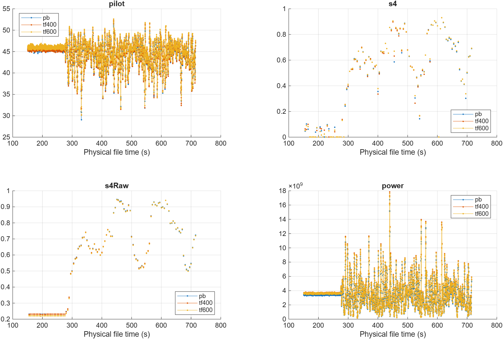
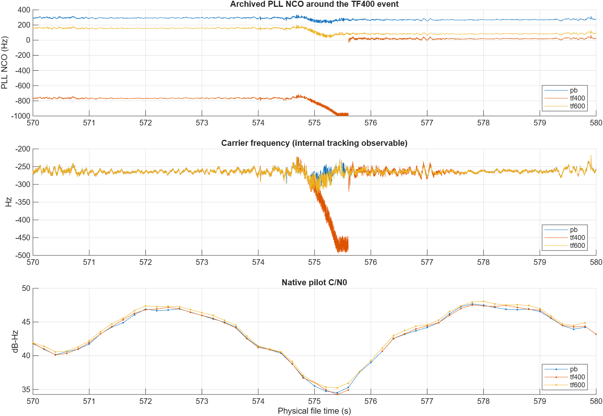

# v0.2.0 升级验收报告

日期：2026-10-01。已完成前端升级及第 4 组带干扰半物理数据的单星验收。分支 `upgrade/v0.2.0-tf-front-end`；升级前工作单独保存在 `d55cc73`，三种完整接收机运行均使用实现提交 `ef246c9`。后续改动为验收脚本、文档及探针显示修复。仅做本地版本控制，不向 GitHub 推送。

## 1. 实现与生效配置

新增 `frontend/`，由 IFSource 负责 IQ 读取、真实前后文和逻辑样本位置，工厂互斥选择 off/PB/TF v1。复 FIR、原始 IF 幅度检测、扩展平台和三角软边缘独立于跟踪环；捕获、跟踪、REACQ 和探针使用同一入口。重捕获缓存不重复滤波，D/H 不进入 GNSS 时间戳。C/N0、S4 继续使用处理后的相关量和原有公式。

| 项目 | 本轮实际设置 |
|---|---|
| 输入 | int16 交织 I,Q，I+jQ，4 字节/复样本，25 MHz，skip=0 |
| 中心/深阻带总宽 | −450 kHz；400/600 kHz，两侧各 150 kHz 过渡带 |
| FIR | 641 抽头，Kaiser β=5.65326；30.69 MHz 默认自动换算为 787 抽头 |
| 幅度阈值 | 192.73917883288581，来自原配置 PB_settings.Th_static_tracking |
| 权重 | 三角核总跨度 12 μs，尾部裕量 2 μs；D/K/P/H=320/150/50/670 |
| 接收机 | PRN 11、串行、1 ms 积分，原 PLL/DLL/FLL/KF 参数 |
| 监测 | C/N0 每 200 ms 更新；S4 60 s 窗、5 s 更新、0.1 Hz 去趋势、150 s 预热 |

支持 int8/int16 IQ、配置采样率及显式奇数抽头覆盖；不对 ADC 幅度自动归一化。保存有效参数、系数、哈希及每个积分核心的有效性/权重统计，halo 不重复计数。上下文无效的积分不进入监测。配置方法见 [USAGE.md](USAGE.md)。

发布实现对深阻带内 4001 点网格的最大幅频响应：25 MHz 下 400/600 kHz 为 −59.203/−59.712 dB；30.69 MHz 下为 −59.154/−59.698 dB。抽头换算保持了这一抑制水平，但不宣称严格 60 dB 或连续频率极值保证；数值和系数哈希见 [频响摘要](evidence/filter_response.json)。

## 2. 数值、时序与回归

- 48 项自动测试全部通过，含 10 项新增前端/配置测试和既有导航、REACQ、S4、EOF、序列化回归。最终前端 10 项另行复跑，新增固定随机种子块长及无 halo 负对照，也全部通过。
- 覆盖 int8/int16 × 25/30.69 MHz × 400/600 kHz 八种组合。对照独立直接卷积双支路，含 1 样本块、脉冲跨界、反向 seek、字节偏移、真实边缘、EOF、门限等号、quiet 恒等、频率符号和元数据分块恢复。卷积容差为输入峰值归一化 1e-12；错开一个样本和去掉真实 halo 均被检出。
- 2 秒实际 IF 故障注入测试以 TrkCN0Th=80 dB-Hz 刻意触发 3 次成功 REACQ，累计 18 ms；每次回退 25000 样本，交接索引一致。此配置不参与性能比较。
- 目录批处理的 JSON、settings 和脚本入口干运行检查通过。新增 MATLAB 文件静态分析无语法错误；既有文件部分风格告警未作无关改写。
- 100 ms 实际 TF400 探针通过。文件起点缺少历史的 670 个样本正确标记无效，其余 2499330 样本有效。修复探针遗留的全局图窗可见性未恢复和负频率轴错一频点问题，复验图窗状态及零频峰坐标通过。

### 2.1 相关保真度

发布诊断位于 `results/upgrade_v020/correlation_release/`：已知 PRN 11 主码、20 ms、两个采样率、两个带宽及 quiet/continuous/gated 三种条件，共 12 组。诊断采用接收机 ceil 边界约定和配置中的**单边 0.5 chip**（总间距 1 chip）；替代先前误用总间距 0.5 chip 的诊断结果。生产接收机参数始终未改。

与独立双支路参考的最大相对误差 **7.11e-15**；quiet 逐值恒等；1/32 样本搜索网格内峰位均为 0，故意错位的峰位均为 +1 样本。下表隔离同一检测权重下的有用码分量，不是残余干扰加信号的总体输出：

| 采样率 | 带宽 | 门控 Prompt 增益 | 门控相位偏差 | DLL 零点偏差 |
|---|---:|---:|---:|---:|
| 25 MHz | 400 kHz | −0.08011 dB | −1.003e-5 rad | −1.328e-6 chip |
| 25 MHz | 600 kHz | −0.10817 dB | 6.058e-8 rad | −3.291e-7 chip |
| 30.69 MHz | 400 kHz | −0.07697 dB | −6.047e-6 rad | −1.522e-6 chip |
| 30.69 MHz | 600 kHz | −0.10469 dB | 1.198e-6 rad | −4.439e-7 chip |

连续全权重滤波的有用 Prompt 损失约 0.48–0.68 dB。门控降低了本诊断的平均损失，但不等于无失真。本诊断没有热噪声、真实跟踪环或 S4 真值。详见 [相关诊断图](evidence/correlation_fidelity.png) 和 [数值摘要](evidence/correlation_summary.json)。

## 3. 实际半物理实验

原始第 4 组：`720_2700_50_1176_25_37p5_17p5.dat`，2700/−50 dBm，72,000,240,000 字节。配置副本只覆盖单星、串行、运行长度、导航/绘图开关及前端模式。原始 RF 和五份 JSON 未改。

30 秒短段 PB/TF400/TF600 均通过，随后三者均完成原时长 715000 ms。完整结果在 `results/upgrade_v020/full_01/{pb,tf400,tf600}/`，包括有效 settings、配置、日志、完整 MAT 和分块数据。总清单 status=complete。运行期间外层 MCP 曾在 300 秒超时，但 MATLAB 心跳和输出持续更新，没有重复启动。

| 方案 | 记录历元 | REACQ 事件/毫秒 | 有效 S4 更新 | 全段 pilot/total C/N0 中位数 (dB-Hz) | 运行时间 (s) |
|---|---:|---:|---:|---:|---:|
| PB | 715000 | 0 / 0 | 114 | 45.3758 / 48.4451 | 725.9 |
| TF400 | 715000 | 1 / 6 | 86 | 45.4201 / 48.5063 | 2133.7 |
| TF600 | 715000 | 0 / 0 | 114 | 45.8164 / 48.8879 | 2476.6 |

三者首个物理样本均为 15483，所有前端积分核心有效、边界无效积分为 0，正常跟踪时间轴误差均为 **0 样本**。715000 是记录历元数，TF400 包含 REACQ 并在成功交接时按原语义回退约 1 ms；不能把其历元号直接视为另外两者相同的文件时间。上述 C/N0 中位数是单模式全段描述，配对收益见下节。运行时间不是独立性能基准，当前实现不满足实时运行。

### 3.1 同一物理时段比较

排除前 150 秒，要求窗口内为正常 LONG 跟踪且前端有效。存档 C/N0 是相邻两次估计的 0.5/0.5 平滑，所以检查完整 400 ms 支持区间，再按物理时间匹配。下表要求窗口重叠至少 99%，不做插值；`覆盖秒数=更新数×0.2`，不是独立样本数。

| 差值方向 | 共同 C/N0 更新 / 覆盖 (s) | pilot 平均差 (dB) | total 平均差 (dB) | ≤2 样本严格配对数 / pilot 差 (dB) |
|---|---:|---:|---:|---:|
| TF400 − PB | 2791 / 558.2 | +0.0361 | +0.0494 | 2127 / +0.0388 |
| TF600 − PB | 2808 / 561.6 | +0.4025 | +0.4070 | 2808 / +0.4025 |
| TF600 − TF400 | 2807 / 561.4 | +0.3656 | +0.3570 | 2127 / +0.3679 |

TF600/PB 最大窗口边缘差为 1 样本（0.04 μs）。含 TF400 的比较在重捕获后相差最多 1 ms，最小重叠率 99.75%；严格子集排除了该段。严格子集不是全时段的随机抽样，需与覆盖范围一起解释。

固定 60/120 秒块至少要求 98% 覆盖，仅报告描述统计。TF600−PB 的 8 个 60 秒块均值为 +0.3771 至 +0.4432 dB，3 个 120 秒块为 +0.3814 至 +0.4417 dB；TF600−TF400 相应为 +0.3451 至 +0.4103、+0.3452 至 +0.4045 dB。收益在本次记录的保留块内一致，没有将高度相关窗口当成独立试验构造置信区间。

稳定时段内部 DLL 鉴别器标准差（无量纲）PB/TF400/TF600 为 0.12316/0.12306/0.12280；PLL 鉴别器标准差为 0.05707/0.05773/0.05690 cycle。这些是内部观测，不是有真值的码或相位误差。Prompt 功率 CV 为 0.59135/0.59785/0.59481，各方案覆盖不完全一致。

共同有效 S4 更新中，TF400−PB 为 85 次、平均差 −0.00261；TF600−PB 为 112 次、+0.00218；TF600−TF400 为 85 次、+0.00407。不能用 TF400 全段中位 S4 较低来宣称更好，因为它缺少后段监测覆盖；没有逐点 S4 真值也不能把差值判为偏差改善。原估计器输出的合法 0 值保留，缺失值保持 NaN。

平均权重 PB 为 0.03861、两个 TF 约为 0.17506。PB 是硬消隐占比，TF 是扩展平台及软边缘的平均滤波权重，不能把它们直接解释成相同的功率损失比例。

### 3.2 TF400 重捕获核查

物理文件约 575.600436 s（历元 575601–575606）发生一次 REACQ。此前 200 ms 的 PLL NCO 全部满足 |NCO|≥950 Hz，占比 100%，超过原有 70% 饱和保护阈值；原上限为 1000 Hz。此前三次存档 total C/N0 为 38.01、37.29、37.41 dB-Hz，高于 25 dB-Hz 门限。保存的 NCO 与代码中的饱和保护条件一致，能够解释该次触发。

逻辑游标从 14390160902 回退至 14390135903，回退 24999 样本，符合缓存末尾一个码周期的交接；该段前端无无效样本。没有发现 FIR 延迟重复补偿或双重滤波。不同方案的 PLL NCO 参考基准受各自捕获/FLL 历史影响，其绝对差不能直接视为真实载波误差。

成功恢复后 S4 重新预热 150 秒，超过本次结束位置，所以 TF400 仅有 86 次有效更新。保留这项实际性能不足；没有提高保护门限或填补监测缺口。该事件限制了对 400 kHz 的稳定性结论，而不是把运行完成等同于性能全面通过。

## 4. 决策、限制与交付

**在第 4 组、PRN 11、当前阈值和环路配置下，600 kHz 是更好的跟踪候选**：共同窗口 pilot C/N0 较 PB 提高约 0.40 dB、较 400 kHz 提高约 0.37 dB，且本次无 REACQ，S4 覆盖完整。仍不能宣称 S4 无偏或对所有干扰条件最优。代码默认保留批准的 400 kHz，600 kHz 可显式配置；后续同组复现建议优先检查 600 kHz。

本轮按最新要求完成至少一组实际验证；其余三组带干扰数据尚未运行，已提供统一驱动。30.69 MHz/int8 已做文件及数值验证，实际完整跟踪使用 25 MHz/int16。未覆盖多星 PVT、所有 KF 路径或前端关闭的全长对照。v2、IIR、在线带宽自适应和 S4 校准不属于本次实现。

小型证据副本已纳入版本控制：[完整运行清单](evidence/validation_manifest.json)、[配对比较](evidence/comparison.json)、[真实重捕获核查](evidence/reacq_audit.json)、[48 项回归](evidence/regression.json)、[最终前端复验](evidence/frontend_release_tests.json)。大体积结果继续保存在忽略目录 `results/upgrade_v020/`；源码/配置基线 ZIP 和 SHA-256 清单位于其 `baseline/`。本地提交和 v0.2.0 标签见 Git；未推送 GitHub。
